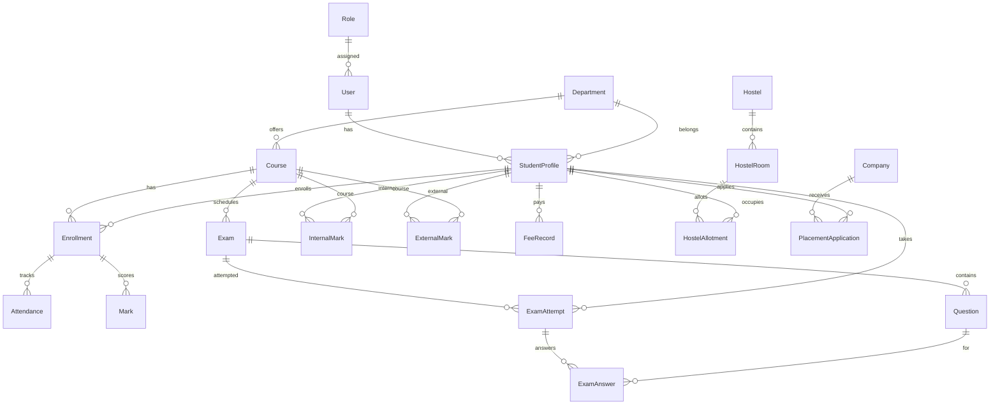

<div align="center">

<h1>College Management System — Backend API</h1>

<p>
  RESTful ASP.NET Core Web API for college operations: identity, academics, online exams,
  results, fees, hostel, placement, timetables, and reporting — backed by SQL Server and Entity Framework Core.
</p>

<p>
  <a href="https://github.com/kirtan1911/CollegeManagement-Backend">Repository</a>
  &nbsp;·&nbsp;
  <a href="#installation-and-configuration">Setup</a>
  &nbsp;·&nbsp;
  <a href="#api-reference">API Reference</a>
  &nbsp;·&nbsp;
  <a href="#database-design">Database</a>
  &nbsp;·&nbsp;
  <a href="#authentication-and-authorization">Security</a>
</p>

<p>
  
  
  
  
  
  
  
  
</p>

</div>

---

## Table of contents

- [Project overview](#project-overview)
- [Key features](#key-features)
- [Technology stack](#technology-stack)
- [Architecture](#architecture)
- [Folder structure](#folder-structure)
- [API reference](#api-reference)
- [Database design](#database-design)
- [Authentication and authorization](#authentication-and-authorization)
- [Prerequisites](#prerequisites)
- [Installation and configuration](#installation-and-configuration)
- [Running the project](#running-the-project)
- [API testing with Swagger](#api-testing-with-swagger)
- [Example API requests](#example-api-requests)
- [Environment variables and security](#environment-variables-and-security)
- [Troubleshooting](#troubleshooting)
- [Future improvements](#future-improvements)
- [Contributing](#contributing)

---

## Project overview

This repository contains the **backend API** for a college management platform. It exposes JSON REST endpoints consumed by a separate static HTML/jQuery frontend (`CollegeManagement-FrontEnd/` in this monorepo workspace).

Verified capabilities in source code include:

| Domain | What the API does |
|--------|-------------------|
| **Identity** | Register, login, JWT issuance, forgot-password OTP via email |
| **Administration** | Dashboard metrics, user/role/status management, departments, courses, student profiles, enrollments |
| **Faculty / staff** | Course roster, attendance and legacy marks entry per course |
| **Student portal** | Profile, enrolled courses, attendance, marks |
| **Exams** | Create exams and questions, student join/submit, attempt history |
| **Assessment** | Internal marks (components + totals), external marks, CGPA-style results via grade scale |
| **Study materials** | Upload to `wwwroot/materials`, list/delete by course |
| **Notifications** | Per-user inbox, mark read / mark all read |
| **Fees** | Admin fee records, student pay and receipts |
| **Hostel** | Hostels, rooms, allotments, occupancy |
| **Re-check** | Student requests, staff/admin processing |
| **Placement** | Companies, applications, placement records |
| **Timetable** | Department/semester schedules, student and faculty views |
| **Reports** | Student/course reports, admin fee summary |

There is **no automated test project** in the solution. Validation is primarily **Data Annotations on DTOs** plus **ModelState** checks in controllers.

---

## Key features

### Authentication and users

- **JWT Bearer** authentication with issuer, audience, signing key, and configurable token lifetime (`Jwt:DurationInMinutes`).
- **BCrypt** password hashing on registration and password reset.
- **Account status** check on login (deactivated users are rejected).
- **Self-service registration** defaults new users to role id `3` (Student) in code.
- **Password reset** flow: `forgot-password` → email OTP (MailKit/Gmail SMTP) → `verify-otp` → `reset-password`, with `resend-otp`.

### Role-based authorization

Roles referenced in `[Authorize(Roles = "...")]` attributes:

| Role | Typical access |
|------|----------------|
| **Admin** | Full admin module, user management, fees, hostel admin, reports (fee summary) |
| **Staff** | Shared with Faculty on many academic endpoints; timetable management; placement admin |
| **Faculty** | Same group as Staff on several controllers (exams, internal marks, reports, etc.) |
| **Student** | Student portal, exams (join/submit), fees (self), hostel allotment, results (self) |

Ensure corresponding rows exist in the `Roles` table (e.g. Admin, Staff, Faculty, Student) so JWT role claims match policy names.

### Data integrity

- Unique indexes on `Users.Email`, `StudentProfiles.EnrollmentNo`, and `(DepartmentId, Semester, CourseCode)` for courses (EF Core configuration + migrations).
- Many relationships use **`DeleteBehavior.NoAction`** to avoid SQL Server cascade cycles.

### API documentation

- **Swagger UI** enabled in **Development** only (`Program.cs`), with JWT **Authorize** support in the UI.

### CORS and static files

- CORS policy **`AllowFrontend`**: allows any origin, header, and method (suitable for local dev; tighten for production).
- **Static files** middleware serves uploaded study materials from `wwwroot`.

---

## Technology stack

| Category | Technology | Version (verified) |
|----------|------------|------------------|
| Language | C# | — |
| Runtime / SDK | .NET | **8.0** (`net8.0`) |
| Framework | ASP.NET Core Web API | 8.0 |
| ORM | Entity Framework Core | 8.0.0 |
| Database | SQL Server (incl. LocalDB) | via `Microsoft.EntityFrameworkCore.SqlServer` |
| Authentication | JWT Bearer | `Microsoft.AspNetCore.Authentication.JwtBearer` 8.0.0 |
| Password hashing | BCrypt.Net-Next | 4.2.0 |
| Email (OTP) | MailKit | 4.7.1.1 |
| OpenAPI | Swashbuckle.AspNetCore | 6.6.2 |
| Source control | Git / GitHub | — |

---

## Architecture

Classic **layered Web API** layout:

```text
HTTP Request
    → HTTPS redirection
    → Static files (wwwroot)
    → Swagger (Development)
    → CORS
    → Authentication (JWT)
    → Authorization (roles)
    → Controller action
    → AppDbContext (EF Core)
    → SQL Server
```

- **Controllers** contain request handling and business logic (no separate repository/service layer except **JwtService** and **EmailService**).
- **DTOs** define API contracts and validation attributes.
- **Models** define EF entities; **`AppDbContext`** lives under `CollegeManagement/Models/` with namespace `CollegeManagementSystem.Data`.
- **Migrations** under `CollegeManagement/Migrations/` evolve the schema.

There is **no custom middleware class**; the pipeline is configured entirely in `Program.cs`.

---

## Folder structure

```text
CollegeManagement-Backend/                 # Repository root
├── CollegeManagement.sln
├── README.md
├── CollegeManagement/                   # Web API project
│   ├── Controllers/                     # REST API endpoints (16 controllers)
│   ├── DTOs/                            # Request/response models + validation
│   ├── Models/                          # EF entities + AppDbContext
│   ├── Migrations/                      # EF Core migrations
│   ├── Services/                        # JwtService, EmailService
│   ├── Properties/
│   │   └── launchSettings.json          # Local URLs & Swagger launch profile
│   ├── wwwroot/
│   │   └── materials/                   # Uploaded study files (.gitkeep in repo)
│   ├── Program.cs                       # DI, JWT, Swagger, CORS, pipeline
│   ├── appsettings.json                 # Non-secret template / local defaults
│   └── CollegeManagement.csproj
└── CollegeManagement-FrontEnd/          # Static UI (not required to run the API)
```

---

## API reference

Base URL (HTTPS profile): **`https://localhost:7142`**  
Base URL (HTTP profile): **`http://localhost:5258`**

Unless noted, endpoints require header: `Authorization: Bearer <JWT>`.

<details>
<summary><strong>Auth — <code>/api/Auth</code></strong></summary>

| Method | Endpoint | Purpose | Auth |
|--------|----------|---------|------|
| POST | `/register` | Create user (default Student role) | Public |
| POST | `/login` | Returns JWT + user info | Public |
| GET | `/admin-dashboard` | Admin smoke test | Admin |
| GET | `/staff` | Staff smoke test | Staff |
| GET | `/student` | Student smoke test | Student |
| POST | `/forgot-password` | Send OTP email | Public |
| POST | `/verify-otp` | Validate OTP | Public |
| POST | `/reset-password` | Set new password after OTP | Public |
| POST | `/resend-otp` | Resend OTP | Public |

</details>

<details>
<summary><strong>Admin — <code>/api/Admin</code> (Admin only)</strong></summary>

| Method | Endpoint | Purpose |
|--------|----------|---------|
| GET | `/dashboard` | Dashboard summary |
| GET | `/total-users` | User count |
| GET | `/total-students` | Student count |
| GET | `/total-staff` | Staff count |
| GET | `/users` | List users |
| PUT | `/change-role/{id}` | Change user role |
| PUT | `/change-status/{id}` | Activate/deactivate user |
| PUT | `/update-user/{id}` | Update user fields |
| DELETE | `/delete-user/{id}` | Delete user |
| GET | `/departments` | List departments |
| POST | `/departments` | Create department |
| PUT | `/departments/{id}` | Update department |
| DELETE | `/departments/{id}` | Delete department |
| GET | `/courses` | List courses |
| POST | `/courses` | Create course |
| PUT | `/courses/{id}` | Update course |
| DELETE | `/courses/{id}` | Delete course |
| GET | `/student-profiles` | List student profiles |
| POST | `/student-profiles` | Create student profile |
| PUT | `/student-profiles/{id}` | Update student profile |
| GET | `/enrollments` | List enrollments |
| POST | `/enroll` | Enroll student in course |
| DELETE | `/enrollments/{id}` | Remove enrollment |

</details>

<details>
<summary><strong>Staff — <code>/api/Staff</code> (Staff, Faculty)</strong></summary>

| Method | Endpoint | Purpose |
|--------|----------|---------|
| GET | `/courses` | Staff member's courses |
| GET | `/course/{courseId}/students` | Roster for a course |
| POST | `/attendance` | Record attendance |
| POST | `/marks` | Record marks (legacy `Mark` entity) |
| GET | `/attendance/{courseId}` | Attendance for course |
| GET | `/marks/{courseId}` | Marks for course |

</details>

<details>
<summary><strong>Student — <code>/api/Student</code> (Student)</strong></summary>

| Method | Endpoint | Purpose |
|--------|----------|---------|
| GET | `/profile` | Student profile |
| GET | `/courses` | Enrolled courses |
| GET | `/attendance` | Own attendance |
| GET | `/marks` | Own marks |
| PUT | `/profile` | Update profile / transport options |

</details>

<details>
<summary><strong>Exam — <code>/api/Exam</code></strong></summary>

| Method | Endpoint | Roles | Purpose |
|--------|----------|-------|---------|
| POST | `/create` | Admin, Staff, Faculty | Create exam |
| POST | `/add-question` | Admin, Staff, Faculty | Add question |
| GET | `/list/{courseId}` | Admin, Staff, Faculty, Student | List exams (secret code hidden from students) |
| DELETE | `/{examId}` | Admin, Staff, Faculty | Delete exam |
| POST | `/join` | Student | Start attempt |
| POST | `/submit` | Student | Submit answers |
| GET | `/my-attempts` | Student | Own attempts |
| GET | `/{examId}/attempts` | Admin, Staff, Faculty | All attempts for exam |

</details>

<details>
<summary><strong>InternalMark — <code>/api/InternalMark</code></strong></summary>

| Method | Endpoint | Roles | Purpose |
|--------|----------|-------|---------|
| PUT | `/update` | Staff, Faculty | Update internal mark components |
| GET | `/course/{courseId}` | Admin, Staff, Faculty | Marks for course |
| GET | `/my-marks` | Student | Own internal marks |

</details>

<details>
<summary><strong>Result — <code>/api/Result</code></strong></summary>

| Method | Endpoint | Roles | Purpose |
|--------|----------|-------|---------|
| GET | `/student/{studentProfileId}` | Admin, Staff, Faculty | Result + CGPA for student |
| GET | `/my` | Student | Own result + CGPA |

</details>

<details>
<summary><strong>StudyMaterial — <code>/api/StudyMaterial</code></strong></summary>

| Method | Endpoint | Roles | Purpose |
|--------|----------|-------|---------|
| POST | `/upload` | Admin, Staff, Faculty | Upload file |
| DELETE | `/{materialId}` | Admin, Staff, Faculty | Delete material |
| GET | `/course/{courseId}` | Authenticated | List materials for course |

</details>

<details>
<summary><strong>Notification — <code>/api/Notification</code> (any authenticated user)</strong></summary>

| Method | Endpoint | Purpose |
|--------|----------|---------|
| GET | `/my` | List notifications for current user |
| PUT | `/read/{id}` | Mark one as read |
| PUT | `/read-all` | Mark all as read |

</details>

<details>
<summary><strong>Fee — <code>/api/Fee</code></strong></summary>

| Method | Endpoint | Roles | Purpose |
|--------|----------|-------|---------|
| POST | `/add` | Admin | Create fee record |
| GET | `/all` | Admin | All fee records |
| GET | `/student/{studentProfileId}` | Admin | Fees for student |
| POST | `/pay/{feeId}` | Student | Pay fee |
| GET | `/my-fees` | Student | Own fees |
| GET | `/receipt/{feeId}` | Student | Payment receipt |

</details>

<details>
<summary><strong>Hostel — <code>/api/Hostel</code></strong></summary>

| Method | Endpoint | Roles | Purpose |
|--------|----------|-------|---------|
| GET | `/` | Admin, Staff, Faculty, Student | List hostels |
| POST | `/` | Admin | Create hostel |
| GET | `/rooms` | Admin, Staff, Faculty, Student | List rooms |
| POST | `/rooms` | Admin | Create room |
| POST | `/allot` | Admin | Allot room |
| DELETE | `/vacate/{allotmentId}` | Admin | Vacate allotment |
| GET | `/my-allotment` | Student | Own allotment |
| GET | `/occupancy` | Admin, Staff | Occupancy report |

</details>

<details>
<summary><strong>Recheck — <code>/api/Recheck</code></strong></summary>

| Method | Endpoint | Roles | Purpose |
|--------|----------|-------|---------|
| POST | `/request` | Student | Submit re-check request |
| GET | `/pending` | Admin, Staff, Faculty | Pending requests |
| PUT | `/process/{requestId}` | Admin, Staff, Faculty | Approve/reject and update marks |
| GET | `/my-requests` | Student | Own requests |

</details>

<details>
<summary><strong>Placement — <code>/api/Placement</code></strong></summary>

| Method | Endpoint | Roles | Purpose |
|--------|----------|-------|---------|
| GET | `/companies` | Admin, Staff, Faculty, Student | List companies |
| POST | `/companies` | Admin, Staff | Create company |
| PUT | `/companies/{id}` | Admin, Staff | Update company |
| DELETE | `/companies/{id}` | Admin | Delete company |
| POST | `/apply/{companyId}` | Student | Apply to company |
| GET | `/my-applications` | Student | Own applications |
| PUT | `/status/{applicationId}` | Admin, Staff | Update application status |
| GET | `/applications/{companyId}` | Admin, Staff, Faculty | Applications per company |
| GET | `/placed-students` | Admin, Staff, Faculty | Placement records |

</details>

<details>
<summary><strong>TimeTable — <code>/api/TimeTable</code></strong></summary>

| Method | Endpoint | Roles | Purpose |
|--------|----------|-------|---------|
| POST | `/` | Admin, Staff | Create entry |
| DELETE | `/{id}` | Admin, Staff | Delete entry |
| GET | `/{departmentId}/{semester}` | Authenticated | Timetable for dept/semester |
| GET | `/my` | Student | Student timetable |
| GET | `/my-schedule` | Staff, Faculty | Faculty schedule |

</details>

<details>
<summary><strong>Report — <code>/api/Report</code></strong></summary>

| Method | Endpoint | Roles | Purpose |
|--------|----------|-------|---------|
| GET | `/my` | Student | Own academic report |
| GET | `/student/{studentProfileId}` | Admin, Staff, Faculty | Report for student |
| GET | `/course/{courseId}` | Admin, Staff, Faculty | Course-level report |
| GET | `/fee-summary` | Admin | Fee summary |

</details>

<details>
<summary><strong>Users — <code>/api/Users</code> (Admin only)</strong></summary>

| Method | Endpoint | Purpose |
|--------|----------|---------|
| GET | `/` | List users |
| GET | `/{id}` | Get user by id |
| PUT | `/{id}` | Update user |
| DELETE | `/{id}` | Delete user |

</details>

---

## Database design

**Provider:** SQL Server (connection string key: `ConnectionStrings:conn`).

**Schema management:** EF Core **migrations** in `CollegeManagement/Migrations/` (apply with `dotnet ef database update`).

### Core entities

`User`, `Role`, `Department`, `Course`, `StudentProfile`, `Enrollment`, `Attendance`, `Mark`, `Exam`, `Question`, `ExamAttempt`, `ExamAnswer`, `InternalMark`, `ExternalMark`, `GradeScale`, `StudyMaterial`, `Notification`, `FeeRecord`, `PasswordResetOtp`, `Hostel`, `HostelRoom`, `HostelAllotment`, `RecheckRequest`, `Company`, `PlacementApplication`, `PlacementRecord`, `TimeTableEntry`.

### Relationship overview (Mermaid)



`GradeScale` is seeded with default letter grades in `OnModelCreating`. `Notification` stores `UserId` without a navigation property in the model.

---

## Authentication and authorization

### Login flow

1. `POST /api/Auth/login` with JSON body `{ "email", "password" }`.
2. On success, response includes `Token`, `User`, `Email`, and `Role`.
3. Send the token on subsequent requests: `Authorization: Bearer <Token>`.

### JWT configuration

Configure in **user secrets**, environment variables, or `appsettings.Development.json` (gitignored):

| Key | Purpose |
|-----|---------|
| `Jwt:Key` | Symmetric signing key (use a strong secret in production) |
| `Jwt:Issuer` | Token issuer |
| `Jwt:Audience` | Token audience |
| `Jwt:DurationInMinutes` | Token lifetime |

If `Jwt:Key` is missing at startup, a **development fallback** string is used in `Program.cs` — replace this for any shared or production environment.

### Password storage

Passwords are stored as **BCrypt hashes** only; plain text is never persisted.

### Email OTP (password reset)

Requires `EmailSettings:SenderEmail`, `EmailSettings:AppPassword`, and optional SMTP host/port. Use a Gmail **App Password** or your provider's equivalent; do not commit real credentials.

---

## Prerequisites

- [.NET 8 SDK](https://dotnet.microsoft.com/download/dotnet/8.0)
- SQL Server or **SQL Server LocalDB** (default connection string uses LocalDB)
- [EF Core tools](https://learn.microsoft.com/en-us/ef/core/cli/dotnet) for migrations:

  ```bash
  dotnet tool install --global dotnet-ef
  ```

- (Optional) Gmail or SMTP account for forgot-password OTP in development

---

## Installation and configuration

### 1. Clone the repository

```bash
git clone https://github.com/kirtan1911/CollegeManagement-Backend.git
cd CollegeManagement-Backend
```

### 2. Restore packages

```bash
dotnet restore CollegeManagement.sln
```

### 3. Configure the database

Edit `CollegeManagement/appsettings.json` or prefer **user secrets** / environment variables for the connection string:

```json
"ConnectionStrings": {
  "conn": "Server=(localdb)\\mssqllocaldb;Database=CollegeManagement;Trusted_Connection=True;MultipleActiveResultSets=true"
}
```

Replace `Server` and authentication as needed for your SQL Server instance.

### 4. Apply migrations

From the repository root:

```bash
cd CollegeManagement
dotnet ef database update
```

This creates/updates the `CollegeManagement` database to match the latest migration snapshot.

### 5. Configure secrets (JWT and email)

**Recommended — user secrets** (project already has `UserSecretsId`):

```bash
cd CollegeManagement
dotnet user-secrets set "Jwt:Key" "YOUR_STRONG_SECRET_KEY_MIN_32_CHARS"
dotnet user-secrets set "Jwt:Issuer" "CollegeManagementSystem"
dotnet user-secrets set "Jwt:Audience" "CollegeManagementSystemUsers"
dotnet user-secrets set "Jwt:DurationInMinutes" "60"
dotnet user-secrets set "EmailSettings:SenderEmail" "your-email@example.com"
dotnet user-secrets set "EmailSettings:AppPassword" "your-smtp-app-password"
```

Alternatively, create `CollegeManagement/appsettings.Development.json` (listed in `.gitignore`):

```json
{
  "Jwt": {
    "Key": "YOUR_STRONG_SECRET_KEY_MIN_32_CHARS"
  },
  "EmailSettings": {
    "SenderEmail": "your-email@example.com",
    "AppPassword": "your-smtp-app-password"
  }
}
```

### 6. Seed roles and admin user

The API does not auto-seed admin accounts in code. After migrations, insert **Role** rows and at least one **Admin** user (with BCrypt hash) directly in SQL or via your deployment process so role names align with JWT policies (`Admin`, `Staff`, `Faculty`, `Student`).

---

## Running the project

```bash
cd CollegeManagement
dotnet run
```

Or open `CollegeManagement.sln` in Visual Studio and run the **https** profile.

Default URLs from `launchSettings.json`:

| Profile | URL |
|---------|-----|
| HTTPS | `https://localhost:7142` |
| HTTP | `http://localhost:5258` |

---

## API testing with Swagger

1. Set `ASPNETCORE_ENVIRONMENT=Development` (default for local profiles).
2. Run the API and open **`https://localhost:7142/swagger`** (HTTPS profile).
3. Call `POST /api/Auth/login`, copy the `Token` value.
4. Click **Authorize**, enter `Bearer <paste-token>`, then invoke protected endpoints.

Swagger is **not** enabled outside the Development environment.

---

## Example API requests

Replace base URL and credentials with your local values.

**Register**

```bash
curl -k -X POST "https://localhost:7142/api/Auth/register" \
  -H "Content-Type: application/json" \
  -d "{\"name\":\"Demo Student\",\"email\":\"student@example.com\",\"password\":\"Password123!\"}"
```

**Login**

```bash
curl -k -X POST "https://localhost:7142/api/Auth/login" \
  -H "Content-Type: application/json" \
  -d "{\"email\":\"student@example.com\",\"password\":\"Password123!\"}"
```

**Authorized request (student profile)**

```bash
curl -k "https://localhost:7142/api/Student/profile" \
  -H "Authorization: Bearer YOUR_JWT_TOKEN_HERE"
```

**Forgot password (requires email settings)**

```bash
curl -k -X POST "https://localhost:7142/api/Auth/forgot-password" \
  -H "Content-Type: application/json" \
  -d "{\"email\":\"user@example.com\"}"
```

---

## Environment variables and security

| Practice | Detail |
|----------|--------|
| **Never commit secrets** | Keep JWT keys and SMTP passwords in user secrets, environment variables, or gitignored `appsettings.Development.json`. |
| **Connection strings** | Use integrated security or managed identities in production; avoid sa passwords in source control. |
| **CORS** | `AllowAnyOrigin` is enabled for development flexibility — restrict origins in production. |
| **HTTPS** | `UseHttpsRedirection` is enabled; terminate TLS properly behind a reverse proxy in deployment. |
| **Uploaded files** | `wwwroot/materials/` is gitignored except `.gitkeep`; scan and quota uploads in production. |
| **Dependencies** | Keep NuGet packages updated; review JWT key rotation procedures for production. |

---

## Troubleshooting

| Issue | Things to check |
|-------|------------------|
| `dotnet ef` not found | Install global tool: `dotnet tool install --global dotnet-ef` |
| Database login failed | Verify `ConnectionStrings:conn` and that SQL Server/LocalDB is running |
| 401 Unauthorized | Token expired, wrong `Jwt:Key`, or missing `Authorization` header |
| 403 Forbidden | JWT role claim does not match endpoint `[Authorize(Roles = ...)]` |
| OTP email not sent | `EmailSettings` missing or invalid; check application logs from `EmailService` |
| Swagger 404 | Ensure environment is **Development** |
| EF migration errors | Run from `CollegeManagement/` project directory; confirm startup project |

---

## Future improvements

Planned or incomplete items observed in project notes (not implemented in this README pass):

- Automated **unit/integration tests** for controllers and auth flows
- Stricter **production CORS** and rate limiting on auth endpoints
- Centralized **exception handling** middleware and consistent error response shape
- Optional **OpenAPI** export in CI for published API docs

See `CollegeManagement/TODO.md` and `CollegeManagement/PROGRESS.md` for module-level history.

---

## Contributing

1. Fork the repository and create a feature branch from `main`.
2. Keep changes focused; match existing C# and API conventions.
3. Do not commit secrets, `appsettings.Development.json`, or uploaded material files.
4. Open a pull request with a clear description and manual test notes (Swagger or curl).

---

<div align="center">

**Maintained by** [kirtan1911](https://github.com/kirtan1911)

</div>
